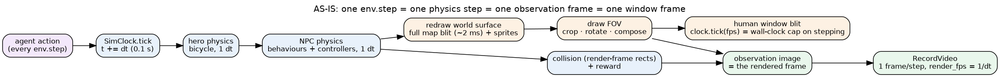
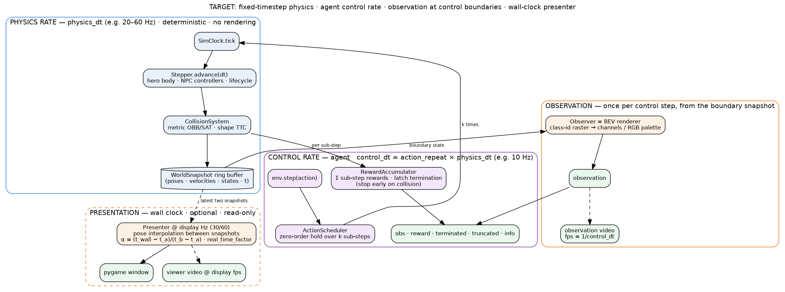
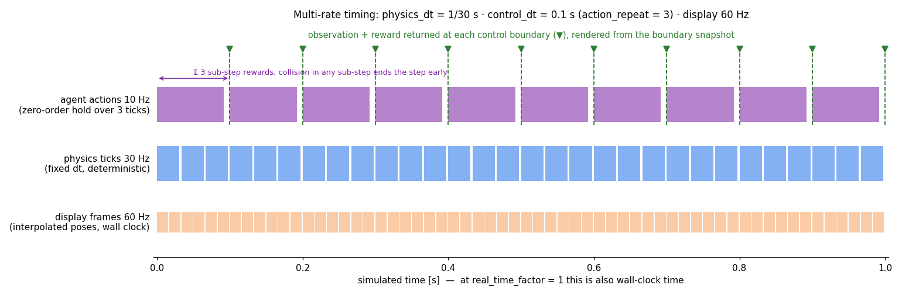
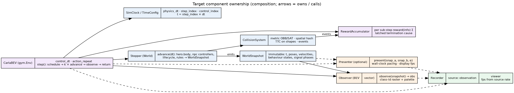

# Multi-Rate Architecture — physics, actions, observations, frames

> Status: **implemented in Phase 5** (slices 1–4 below). Companion to
> [simulation_clock_and_units.md](simulation_clock_and_units.md) and
> [benchmarking.md](benchmarking.md). Sections 1–4 are the original design;
> section 6 maps it to the implementation.

## 1. The problem

Today one `env.step()` is simultaneously

1. one **physics step** (`physics_dt`, 0.1 s),
2. one **agent decision** (the action is applied for exactly that step),
3. one **observation frame** (the BEV is rendered from the state after the step),
4. one **window frame** in `human` mode (blit + `clock.tick(fps)`, which only *caps*
   how fast steps may happen).

Consequences: the physics rate cannot be raised without also raising the
agent's decision rate and the observation rate (cost and task change together);
the human viewer can only show 1/dt frames per second (10 fps at real time) and
anything smoother requires fast-forwarding the simulation; video capture is
forced to the physics rate; and rendering work (the ~2 ms world redraw) is paid
on every physics step even when no observation is needed.

## 2. Target: four rates, one clock

| Rate | Owner | Typical value | Meaning |
| --- | --- | --- | --- |
| **physics** `physics_dt` | `SimClock` / `Stepper` | 1/20 – 1/60 s | integrator step for ego and NPCs; deterministic; no rendering |
| **control** `control_dt = action_repeat × physics_dt` | `CarlaBEV.step` | 0.1 s | one agent action, held (zero-order) over `k` sub-steps; rewards summed; termination latched (a collision in sub-step 2 of 3 ends the step early) |
| **observation** | `Observer` | = control rate | one observation per control step, rendered from the *boundary* snapshot (optionally with sub-step history for temporal fusion) |
| **display** | `Presenter` | 30/60 Hz wall clock | optional, read-only: interpolates actor poses between the two latest `WorldSnapshot`s; never influences the simulation |

### Components (composition, no new inheritance)

| Component | Responsibility | Exists today as |
| --- | --- | --- |
| `TimeConfig` / `SimClock` | `physics_dt`, `step_index`, `control_index`, `t = step_index·dt`, horizons in seconds | ✔ (add `action_repeat`, `control_dt`, `control_index`) |
| `ActionScheduler` | decode once, hold over `k` sub-steps (zero-order; continuous actions could be linearly ramped later) | implicit in `_simulate` |
| `Stepper` (World) | `advance(dt)`: hero body, NPC controllers, lifecycle, rules; emits a `WorldSnapshot` | `Scene._scene_step` + `BaseMap.step` (includes drawing — to be split out) |
| `CollisionSystem` | metric shapes (Phase 2), events per sub-step | `Scene.collision_check` on render rects |
| `RewardAccumulator` | per-sub-step `reward_fn.step(info)`, Σ, first terminal cause wins | `reward_fn.step` once per step |
| `WorldSnapshot` | immutable poses/velocities/behaviour states/signal phases at `t` | — (actors are mutated in place) |
| `Observer` | `observe(snapshot) → obs` (BEV class-id raster → channels/RGB; vector) | `BaseMap.draw_fov` + `render()` |
| `Presenter` | wall-clock paced, `present(snap_a, snap_b, α)`, `real_time_factor`, display fps | `Renderer.render` (one blit per step) |
| `Recorder` | video from the observation stream (`fps = 1/control_dt`) or from the presenter (`display fps`) | `RecordVideo` on observations |

### Semantics that must hold

- **Determinism and the observer rule** stay exactly as enforced now: the
  presenter reads snapshots and cannot write; `fps`/display rate never changes
  the trajectory (existing digest tests extend to `action_repeat > 1`).
- **Task defined in seconds**: horizons, timers, scenario parameters are already
  in simulated seconds; `control_dt` changes the agent's decision rate, not the
  task. Rewards are summed over sub-steps so per-second reward density is
  invariant to `action_repeat` for rate-like terms (progress, time penalties);
  per-decision terms (action smoothness) are evaluated once per control step.
- **Termination inside a control step** ends the step early: the returned
  observation is the state at the terminal sub-step, `sim_time_s` reflects it.
- **Frame-skip observation**: the observation is rendered once per control
  step (boundary snapshot). Optionally expose `observation_substeps` to stack
  intermediate frames for temporal-fusion wrappers (cost: one render per
  sub-step).

## 3. Trade-offs and comparison with the current state

| Aspect | Current (1:1:1:1) | Target (multi-rate) |
| --- | --- | --- |
| Physics fidelity | bounded by the decision rate (10 Hz) | free: 20–60 Hz at the same decision rate; finer collision timing for realistic footprints |
| Cost per agent decision | 1 physics step + 1 render ≈ 4–6 ms | `k` physics steps (≈ 1.5–3 ms each, no drawing) + 1 render; at `k = 2`: ≈ 6–9 ms; at `k = 3`: ≈ 8–12 ms |
| Steps/s at the decision level | ≈ 170–320 decisions/s, 17–32× real time | ≈ 100–150 decisions/s at `k = 2` (9–15× real time); `k = 6` (60 Hz physics) ≈ 40–60 decisions/s (≈ 3–5× real time) |
| Human viewer | 10 fps at real time; "smooth" only by fast-forwarding | 30/60 fps at real time by interpolation (cheap, visual only) **or** by running physics at display rate with `action_repeat` (true frames, more compute) |
| Observation video | plays at 1/dt; tied to physics | plays at the decision rate; viewer video independently at display fps |
| Reward semantics | per step = per decision = per 0.1 s | per decision = Σ over sub-steps; rate terms dt-invariant; explicit rule for per-decision terms |
| Collision detection | once per 0.1 s (up to 1.4 m of travel between checks) | every sub-step (0.3–0.7 m at 20–50 Hz) |
| Determinism | enforced, 1 frame per step | unchanged for physics/observations; presenter interpolation is non-deterministic in *wall time* but never feeds back |
| Complexity | minimal | `ActionScheduler`, `RewardAccumulator`, `WorldSnapshot`, `Presenter`: ~4 small classes; `Scene` stops drawing inside the physics step |
| Backwards compatibility | — | `action_repeat = 1` and `physics_dt = 0.1` reproduce today's behaviour bit-for-bit (goldens unchanged); `render_fps` becomes `1/control_dt` |

### Options considered

| Option | Description | Verdict |
| --- | --- | --- |
| A. Lower `physics_dt` only | keep 1:1; agent decides at 20–50 Hz | simplest, but changes the task (decision rate) and multiplies observation renders; not recommended |
| B. `action_repeat` only | decouple physics from decisions; viewer stays at 1 frame per physics step | gets all training-side benefits (fidelity, cost control); viewer smoothness comes from higher physics rate; **recommended first slice** |
| C. B + `Presenter` with interpolation | viewer/video at 30/60 Hz regardless of physics rate | needs `WorldSnapshot` and the layered renderer (Phase 3); cheap visually, zero impact on training; **second slice** |
| D. Threads/async presenter | render in another thread while physics runs | avoid: pygame/SDL is single-threaded on most platforms and it adds non-determinism for no training benefit; the presenter can run inline at the control boundary and interpolate *within* the control step instead |

## 4. Recommended configuration presets

| Use | `physics_dt` | `action_repeat` | `control_dt` | display |
| --- | --- | --- | --- | --- |
| Training (default) | 0.05 | 2 | 0.1 | off |
| Training, legacy-compatible | 0.1 | 1 | 0.1 | off |
| Interactive debugging | 1/30 | 3 | 0.1 | 30 fps true frames, real time |
| Demo / video | 1/60 | 6 | 0.1 | 60 fps true frames |

## 5. Implementation slices (as built)

1. **`action_repeat` + sub-step accumulation** — `TimeConfig.action_repeat`,
   `control_dt`, `EnvConfig.action_repeat`; `CarlaBEV.step` loops `k` sub-steps
   (physics + collision + reward) and renders once; `render_fps = 1/control_dt`;
   `episode_info` gains `control_dt_s`, `decisions`; tests: bit-identical at
   `k = 1`, dt-invariance of summed rewards, early termination, video rate.
2. **Split drawing out of the physics step** — `Scene._scene_step` no longer
   redraws the world; `Observer.observe()` draws on demand (also removes the
   2 ms redraw from every sub-step).
3. **`WorldSnapshot` + `Presenter`** (after Phase 3 renderer) — interpolated
   30/60 Hz viewer with wall-clock pacing and `real_time_factor`; viewer video.
4. **Benchmark** — throughput suite reports decisions/s and physics steps/s per
   `(physics_dt, action_repeat)`; rendering suite verifies presenter
   independence.

## 6. Implementation map (Phase 5)

| Design component | Implementation |
| --- | --- |
| `TimeConfig.action_repeat`, `control_dt`, `control_index` | `src/sim_time.py` (`TimeConfig.control_dt_s`, `render_fps = round(1/control_dt)`, `SimClock.begin_control_step()`); `EnvConfig.action_repeat` |
| `ActionScheduler` (zero-order hold) | `CarlaBEV.step`: decode once, loop `action_repeat` × `_simulate(decoded)` |
| `Stepper.advance(dt)` without drawing | `BaseMap.advance(action)` (scene step + semantic tile/heading for the outcome); `BaseMap.render_world()` draws once per control step; `BaseMap.step()` = both (legacy 1:1 entry) |
| `RewardAccumulator` | sub-step rewards summed (`info["reward"]["control_reward"]`, `substep_rewards`), first terminal cause latches and ends the control step; per-step rewards scaled by `dt / 0.1` (`REWARD_REFERENCE_DT_S`, finding R-06) |
| `WorldSnapshot` | `envs/presenter.py::WorldSnapshot.capture(scene)` (hero pose, actor bodies, target/strip rects); `interpolate(other, alpha)` |
| `Presenter` | `envs/presenter.py::Presenter` — `EnvConfig.display_fps` (human mode): `display_fps × control_dt` frames per control step interpolated between the sub-step snapshots, own `FovRenderer` output, wall-clock paced (`real_time_factor = 1`); lags one control step; mutually exclusive with `fps` (frame cap / fast-forward) |
| `Recorder` | `RecordVideo` on observations at `metadata["render_fps"] = 1/control_dt` |
| Benchmark | throughput suite table `multi_rate` (`decisions_per_s_*`, `physics_steps_per_s_*` for (0.1, 1), (0.05, 2), (0.025, 4)); validator `action_repeat_consistency` |

Presets (`carlabev run sim --physics-dt … --action-repeat … [--display-fps …]`):

| Use | `physics_dt` | `action_repeat` | `control_dt` | display |
| --- | --- | --- | --- | --- |
| Legacy-compatible training (default) | 0.1 | 1 | 0.1 | off |
| Finer physics, same task | 0.05 | 2 | 0.1 | off |
| Interactive debugging | 0.05 | 2 | 0.1 | `--display-fps 30` (interpolated, real time) |
| Demo / video | 1/60 | 6 | 0.1 | `--display-fps 60` |

Measured (lead_brake, 128 px, rgb_array, this sandbox): 753 decisions/s at
(0.1, 1); 518 decisions/s = 1035 physics steps/s at (0.05, 2); 273 decisions/s
= 1092 physics steps/s at (0.025, 4) — rendering is paid once per decision, so
the physics rate can be raised at roughly the cost of the sub-steps alone.

Semantics guaranteed by tests (`tests/physics_time/clock/test_action_repeat.py`,
`rendering/test_presenter.py`): `env(dt, k)` step `n` equals `env(dt, 1)` step
`k·n` bit for bit (state and observation) with summed rewards; a terminal
sub-step ends the control step with `sim_time_s` at that sub-step; `k = 1` is
the legacy step; the presenter never changes trajectory, observation or time.
