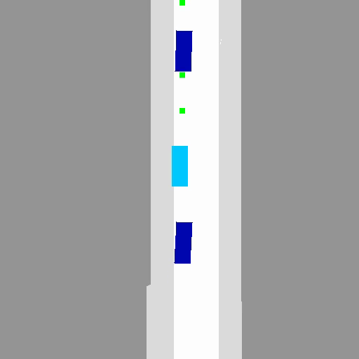
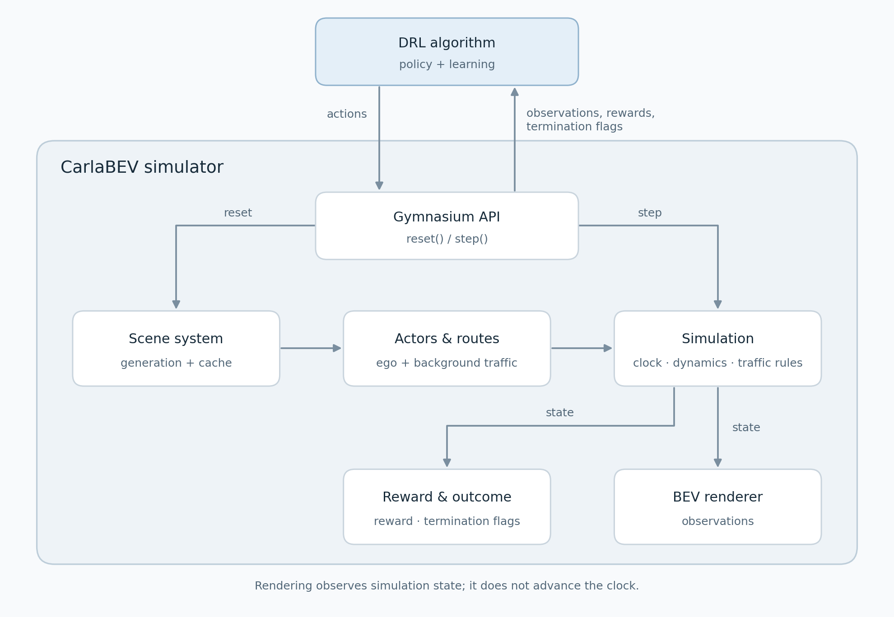

# CarlaBEV

A lightweight bird’s-eye-view driving simulator for reinforcement-learning research, with a Gymnasium API, procedural traffic, and repeatable scenarios on Town01. It uses simplified vehicle dynamics for fast experimentation.



*Random Town01 traffic, rendered at 512 × 512: ego in cyan, traffic in blue, and route checkpoints in green.*

## Install and run

Requires Python 3.12+ and [uv](https://docs.astral.sh/uv/).

```bash
git clone --branch alignerr https://github.com/danielmtzbarba/carlabev-env.git
cd carlabev-env
uv sync
uv run carlabev run sim --size 512
```

Drive with the arrow keys; press **Q** to quit. For a smoother display:

```bash
uv run carlabev run sim --size 512 --display-fps 60
```

Run headless episodes or change traffic difficulty:

```bash
uv run carlabev run sim --control random --episodes 5
uv run carlabev run sim --size 512 --difficulty-preset-id hard --seed 1
```

## Settings

| Option | Purpose |
| --- | --- |
| `--size 256` or `--size 512` | Native raster resolution; the physical field of view stays the same. |
| `--control manual\|random\|idle\|forward` | Select keyboard or automatic actions. |
| `--difficulty-preset-id easy\|medium\|hard` | Choose random-scene traffic difficulty. |
| `--physics-dt 0.05` | Set physics time per substep, in seconds; default is `0.1`. |
| `--action-repeat 2` | Hold each action for two physics substeps. |
| `--seed 5` | Set the base scene seed. |
| `--record-video runs/videos` | Record episode videos. |

`--display-fps` changes presentation; `--physics-dt` changes simulation time. Use `uv run carlabev run sim --help` for all options, or see the [configuration reference](CarlaBEV/docs/config_reference.md) for Python configuration.

## Features

- Gymnasium environments with discrete or continuous ego actions.
- RGB and semantic BEV observations, frame stacking, and direct vector observations.
- Random traffic with car following, signals, junction yielding, and vehicle recycling.
- Authored scenes and `lead_brake`, `jaywalk`, and `red_light_runner` scenarios.
- Metric actor footprints, collision detection, and curvature-aware NPC speed control.
- Seeded scene generation, cached scene libraries, and replay validation.

## Train a DRL agent

Use CarlaBEV through Gymnasium’s `reset()` and `step()` API. The environment factory adds observation resizing, semantic masks, frame stacking, and episode statistics:

```python
from CarlaBEV.config import EnvConfig, RunConfig
from CarlaBEV.envs import make_env

envs = make_env(RunConfig(
    num_envs=8,
    env=EnvConfig(render_mode="rgb_array", obs_mode="bev_semantic"),
))
observations, info = envs.reset(seed=42)
try:
    for _ in range(1_000):
        actions = envs.action_space.sample()  # Replace with policy(observations).
        next_observations, rewards, terminated, truncated, info = envs.step(actions)
        # Store the transition and update your DRL algorithm here, before resets.
        observations = next_observations
        done = terminated | truncated
        if done.any():
            observations, info = envs.reset(options={"reset_mask": done})
finally:
    envs.close()
```

The example samples random actions; replace that line with your policy. Actions and transitions are batched across environments. Autoreset is disabled, so reset completed environments using `reset_mask`. Keep `terminated` and `truncated` separate when computing learning targets. See the [training integration contract](CarlaBEV/docs/downstream_integration_api.md) for details.

## Architecture



The simulation advances on an explicit clock. Rendering observes its state and does not control physics timing.

[Documentation](CarlaBEV/docs/README.md) · [Python integration](CarlaBEV/docs/downstream_integration_api.md) · [Scenarios](CarlaBEV/docs/scenario_specifications.md) · [Diagnostics and validation](CarlaBEV/docs/debugging_and_diagnostics.md)

Original software and documentation are licensed under [Apache-2.0](LICENSE.md).
